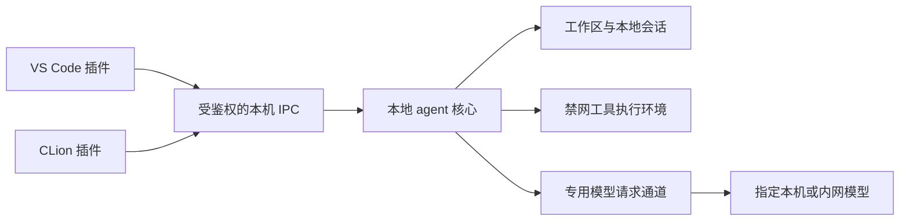

# Cline 本地／内网专用 Fork：需求与改造方案

状态：以下为最初的需求与方案记录。已新增独立离线发行版 `apps/local-only/`，复用 Cline Agent 循环，提供 VS Code 与 CLion 宿主、受限模型通道、本地工具及 Linux 命令沙箱；已生成本地安装包。实际支持范围、构建和验证边界以 [发行版说明](apps/local-only/README.md) 为准。

本文依据当前仓库源码制定，不代表原版已经满足下列限制。发现某项上传能力不等于它默认启用，也不代表已观察到上传行为。

## 1. 产品目标与边界

已明确的目标：

- 只交付 VS Code 与 CLion 插件，安装、启动和使用均不依赖互联网。
- 保留本地 agentic 编程：理解项目、读取与搜索代码、提出和应用修改、展示差异、运行本地构建与测试、保存本地会话。
- 移除互联网服务、代码外传、遥测、错误上报、在线账号、云端会话、远程配置、在线市场及自动更新。
- 支持用户自行部署的模型，不依赖任何公有云模型账号。
- 本地安装、手动替换安装包；用户机器无需在首次运行时下载依赖或运行时。

**实施采用的数据边界：**根据用户后续明确的家庭局域网模型场景，仅允许向用户明确配置的本机／内网模型发送完成任务所需的上下文。远程推理通常会发送用户问题、相关源码、差异、工具输出和部分会话历史。若代码不得离开本机，则模型只能运行在本机。没有配置模型端点时，不允许发送任何上下文。

这里的“离线”指不依赖公网；若允许内网推理，仍保留这一条受限的网络通道。模型 API 请求包含代码时，同样属于数据传输，不能通过改名为“推理”来回避数据边界。

最终交付必须包含两个 IDE 的可安装产物。先完成 VS Code 是实施顺序，不能把它视为完成了 CLion 支持。

## 2. 当前仓库事实与改造入口

以下是初步审计入口，不是完整的依赖或网络调用清单。实施时应继续追踪导入、初始化、定时任务和产物中的可达代码。

| 范围 | 当前源码依据 | 离线版要求 |
| --- | --- | --- |
| VS Code | `apps/vscode/src/extension.ts`、`apps/vscode/src/common.ts` | 使用独立插件标识、存储目录和离线启动流程 |
| CLion / JetBrains | 根 `README.md` 的产品表明确说明 JetBrains 插件未开源；当前仓库没有该插件工程 | 自建 CLion 宿主适配器，不能承诺直接打包原版 JetBrains 插件 |
| 可复用宿主接口 | `apps/vscode/src/hosts/external/`、`apps/vscode/src/standalone/` | 评估复用本地协议；这些目录不等于完整的 CLion 插件 |
| 遥测、错误、实验开关 | `apps/vscode/src/services/telemetry/`、`services/error/`、`services/feature-flags/`，以及 `sdk/packages/core/src/services/telemetry/` | 从初始化路径和运行产物移除上报实现，不留设置开关重新开启 |
| 账号、远程配置、云端会话 | `apps/vscode/src/sdk/auth-service.ts`、`src/core/storage/remote-config/`、`sdk/packages/core/src/cloud/` | 移除登录、组织、额度、远程配置、云会话与远程执行入口 |
| 会话／提示词上传 | `apps/vscode/src/common.ts`、`src/shared/services/worker/`、`src/shared/storage/ClineBlobStorage.ts`；`sdk/packages/shared/src/remote-config/blob-storage.ts`、`sdk/packages/core/src/remote-config/integration.ts` | 删除同步队列、历史回填、对象存储上传及相应配置入口；不能只关闭遥测 |
| 市场、MCP、动态插件 | `apps/vscode/src/core/controller/marketplace/marketplace-helpers.ts`、`services/mcp/`；`sdk/packages/core/src/services/plugin-install.ts`、`src/extensions/plugin/`、`src/extensions/mcp/` | 首版移除市场、MCP、动态插件及可执行 hooks，避免额外联网与执行通道 |
| 网页与浏览器 | `apps/vscode/src/services/browser/`、`sdk/packages/core/src/extensions/tools/executors/web-fetch.ts` | 删除工具注册、执行器、URL 上下文抓取、浏览器下载及远程连接入口 |
| 外部 webhook | `apps/vscode/src/services/lg-cns-integration/webhook-hooks.ts` | 移除对外 webhook 及其触发路径 |
| 模型接口 | `sdk/packages/llms/src/providers/vendors/openai-compatible.ts`、`src/providers/builtins-runtime.ts`；`apps/vscode/src/core/controller/models/` | 收敛到专用本地模型适配器；现有兼容适配器还包含云网关分支，不能原样视作离线实现 |
| Webview | `apps/vscode/src/core/webview/WebviewProvider.ts` | 当前生产 CSP 含远程连接与 HTTPS 图片来源；离线版仅加载随包资源，禁远程图片、字体、脚本和网页导航 |
| 终端执行 | `apps/vscode/src/sdk/vscode-runtime-builder.ts`、`vscode-run-commands-tool.ts`；`sdk/packages/core/src/extensions/tools/executors/bash.ts` | 必须覆盖 IDE 自定义终端与 SDK 执行器，不能只修改一处 |
| 发布与打包 | `apps/vscode-rollout/src/rollout.ts`、`apps/vscode/esbuild.mjs`、`apps/vscode/scripts/package-standalone.mjs`、`download-ripgrep.mjs` | 排除在线分流层和上报配置注入；预置平台依赖；删除安装和运行阶段下载回退 |

现有 `subprocess-sandbox.ts` 等模块名不能作为网络隔离证据，必须验证实际执行权限及子进程行为。仅选择自托管端点也不能证明所有其他联网能力已经移除。

## 3. 功能范围

| 保留 | 删除 |
| --- | --- |
| 本地文件读取、搜索、项目上下文 | 公网搜索、网页读取、浏览器自动化 |
| 对话、计划、修改、差异审阅、撤销 | 云会话、分享、远程任务与云端同步 |
| 本地构建、测试和编译错误反馈 | 账号登录、OAuth、额度、付费与组织控制面 |
| 本地会话历史和检查点 | PostHog、OpenTelemetry 导出、错误与崩溃上传 |
| 指定本机／内网模型、流式回复、工具调用 | 公有云 provider、云端 fallback、在线模型目录 |
| 本地规则及纯文本技能 | 在线市场、MCP、动态插件、可执行 hooks |
| 本地模型设置和本地诊断日志 | 更新检查、更新下载、公告拉取、远程 feature flags |

规则、技能、仓库文件、模型回复和恢复的历史任务均不能修改安全策略。诊断日志默认不记录源码、完整提示词、密钥与请求体；历史会话可能含代码，只允许保存在独立本地数据目录。忽略规则应在上下文采集入口执行，但忽略文件不是访问控制或网络隔离措施。

## 4. 共用架构

拟采用两个轻量 IDE 宿主、一个裁剪后的本地 agent 核心。VS Code 可复用现有 UI 与宿主集成；CLion 需要新建插件工程，实现工具窗口、编辑器上下文、差异审阅、诊断、取消与生命周期管理。

- 默认不启动共享 hub，不连接远程 hub，不复用用户已有 Cline 云端或组织配置。
- 核心与 IDE 优先使用 stdio 或受权限保护的本地 IPC。若使用回环 TCP，必须限定回环地址、鉴权、验证请求来源及工作区范围，禁止监听全部网卡。
- 模型通道只提供选定推理协议，不提供任意 HTTP 代理、文件上传、URL 抓取或 shell 接口。
- 所有上下文压缩、任务标题、子任务等辅助推理也使用同一受限端点，不能偷偷回退到其他 provider。
- 独立进程便于控制权限，但“独立进程”本身不等于沙箱。网络策略需覆盖 IDE、核心、工具子进程、Webview，以及可能被它们委托执行的其他进程。

## 5. 模型端点策略

首版拟只实现 OpenAI 兼容的 Chat Completions 流式推理与工具调用。用户可以把现有本地模型服务器作为端点，但必须实测其请求格式、SSE、工具参数与取消行为；不能仅凭服务名称认定兼容。不提供自动下载模型能力。

最小设置：端点地址、端口、API 路径、模型 ID、可选内网凭证、上下文上限和输出上限。凭证保存在宿主安全存储或权限受限的本地存储中。

强制策略：

1. 默认拒绝网络连接。只允许管理员明确指定的模型端点；不能放行整个内网或所有回环端口。缺失或损坏的配置直接失败，不使用公网默认值。
2. 首版优先限定规范化后的字面 IP。局域网端点只接受明确批准的私有地址；云元数据地址、链路本地、组播、未指定地址等不作为可用模型端点。IPv6 与 IPv4 映射形式需要等价检查。
3. 如以后支持内网域名，需使用受控内网解析、检查全部解析结果，并将校验绑定到实际连接地址，防止解析变化绕过；不能只检查域名后缀。
4. 精确约束协议、地址、端口、请求方法和路径。只允许推理请求及确有必要的模型列表请求；不允许同一服务器上的任意路径。
5. 禁止 HTTP 自动重定向，禁止继承系统／环境中的外部 HTTP、HTTPS、SOCKS 代理或 PAC。请求被拒绝时，在发送请求体之前失败。
6. 禁止 workspace 配置、环境变量、历史任务、模型回复和远程配置扩大允许范围；环境中的云凭证、上传和 OTEL 配置不能激活已删除能力。
7. 模型服务不可用、返回错误或协议不兼容时，给出本地错误，不尝试公网备用服务。
8. 如使用 HTTPS，保留证书校验，允许通过受控配置安装内部 CA，不用关闭 TLS 校验来处理自签证书。

端点允许接收上下文的例外仍需确认。内网模型服务器也必须限制外连、禁用云端路由及外部日志上报；客户端无法单独约束服务器收到代码后的行为。

## 6. “绝对禁止外传”的执行边界

删除联网模块可以消除应用自身的预期请求，但 agent 仍能运行脚本、测试、编译器插件或 Git hooks。命令字符串黑名单、确认弹窗、忽略文件和替换 `fetch` 都不足以保证这些进程无法联网。

严格版本必须满足：

- 工具子进程及其后代由操作系统级策略禁止网络访问，包含 TCP、UDP、DNS、IPv4、IPv6、代理和后台进程。
- 工具执行环境不能访问允许联网的本机代理、Docker 等控制 socket、模型通道凭证或用于修改网络策略的配置；不授予提权能力。
- IDE 终端入口不能绕过隔离环境。隔离不可用时，拒绝执行命令，不静默回退到普通终端。
- 对本地构建和测试，依赖必须已存在；缺少依赖明确报错，不执行在线安装。Git 网络操作和仓库 hooks 同样受限。
- 审查 agent 写入文件后触发的 IDE 自动任务、文件监视器和构建服务。严格部署应将整个 IDE 工作环境置于受控网络边界内，避免委托宿主进程绕过限制。
- Webview、IDE 插件宿主和本地核心采用相应出站策略；只给模型通道放行指定端点，不把某个语言运行时的所有进程统一放行。

实际系统策略需按 Windows、Linux、macOS 分别实现与验证。目标系统尚未指定，因此不能现在宣称已具备跨平台的外传保证。在支持平台完成隔离验收之前，不应发布为“绝对禁止上传代码”的版本。

## 7. 离线安装与更新

- VS Code 交付具有独立 `publisher.name` 的 `.vsix`；CLion 交付具有独立插件 ID 的本地安装包。不得继续使用官方插件身份，以免混淆安装与更新来源。
- 移除插件自身的更新和在线分流逻辑，不配置在线更新源。IDE 自身的市场查询与自动更新需要部署侧管理，插件内的开关不能替 IDE 作保证。
- 为每个支持的系统／架构预置运行时、ripgrep、原生模块、Webview 资源和必要数据，不允许首次启动下载。缺少平台组件立即显示本地错误。
- 构建依赖和发布产物分开管理：预先准备可信依赖缓存，锁定版本，在离线构建环境打包；用户安装与运行期间没有包管理器或下载步骤。仓库 TypeScript 工具链使用 Bun 1.4.2、Node >=22。
- 本地分发包附带校验值、第三方依赖清单、原仓库要求的许可文件、安装与网络策略说明。
- 首次启动不导入原版的凭证、上传队列、远程配置、MCP 或插件配置。若支持历史迁移，只迁移经过审查的本地数据，不恢复上传任务。
- 用户手动替换安装包；没有后台检查、更新提示请求或自动补丁通道。

## 8. 实施顺序与完成标准

| 阶段 | 工作 | 完成证据 |
| --- | --- | --- |
| A：冻结边界 | 确认模型数据例外、目标系统／架构、模型 API 和 IDE 版本范围；追踪全部网络与执行入口 | 确认的需求、入口清单及可复现基线构建 |
| B：裁剪公共核心 | 移除云 provider、遥测、上传、远程配置、市场、MCP、hooks、Web 工具；加入专用模型通道 | 运行产物依赖审计、端点策略测试、断网推理集成测试 |
| C：VS Code | 清理 UI、命令、设置、CSP 和终端路径，隔离数据目录，打包 | 全新环境离线安装的 VSIX，完成代码修改与测试闭环 |
| D：CLion | 新建宿主适配器，复用已裁剪核心，实现 UI、上下文、diff、取消和本地生命周期 | CLion 本地安装包及同一套功能／网络验收 |
| E：强制隔离与交付 | 按平台落实网络、子进程与宿主边界，检查产物依赖和后台行为 | 每个目标平台的抓包、拒绝日志、可重复测试及安装文档 |

应用层和平台隔离应在开发中尽早联调，不能等功能完成后才验证。若某个平台没有可靠隔离，明确标为未完成，不降低“禁止外传”要求。

## 9. 验收用例

全部验收在隔离测试环境中使用合成项目与虚构敏感标记，不使用真实源码测试外传。

| 场景 | 必须满足的结果 |
| --- | --- |
| 全新用户、断开公网、本地安装与首次启动 | 无账号、无下载、无公网 DNS 或连接尝试；设置界面可用 |
| 未配置模型或模型地址非法 | 在发送上下文前拒绝，禁止默认云端 fallback |
| 指定内网模型完成任务 | 读取合成项目、流式回复、工具调用、修改 diff、隔离环境构建测试、保存和恢复会话均可用 |
| 代码传输审计 | 合成标记只出现在批准的模型请求及允许的本地存储；其他接收端零字节 |
| 公网 IP、域名、特殊 IP、未批准内网端口、混合 IPv6 表示 | 全部拒绝；不能靠 URL 编码或地址表示差异绕过 |
| 模型端点返回重定向或异常 | 不发送后续请求、不外传请求体或凭证、不启用备用 provider |
| 注入代理、云密钥、OTEL、对象存储环境变量及旧配置 | 不能恢复遥测、上传、远程配置或改变模型端点 |
| 恶意 Markdown 图片、远程 CSS、链接与 URL 上下文 | 无外部资源请求、外部浏览器跳转或网页抓取 |
| 命令、测试脚本、Git hook 和后台后代尝试联网 | HTTP、原始 socket、DNS 和代理访问均由系统策略阻断 |
| 本机代理与宿主委托绕过 | 工具不能通过本机服务、控制 socket、IDE 任务获得外连能力 |
| 工作区、模型输出或历史任务尝试改变策略 | 拒绝修改允许端点和禁网规则；不能注册新工具或 provider |
| 启动、空闲、重试、异常、任务恢复及退出 | 覆盖原有定时器与重试窗口，无遥测、同步、公告、模型目录、更新请求 |
| 依赖缺失、网络策略加载失败 | 明确失败，不下载、不改用未隔离进程 |
| VS Code 与 CLion 分别验证 | 两个 IDE 均满足以上用例；单端通过不算整体完成 |
| 最终产物审计 | 云端服务、上传适配器、远程市场等实现不进入发布运行产物，安装包不触发下载 |

验收应同时结合源码／构建依赖审计、实际网络观测和主动绕过测试。静态 URL 搜索只能定位线索，不能区分文档链接与实际请求，也不能证明不存在运行时拼接地址。

## 10. 尚需输入的信息

- 是否明确允许将任务相关代码上下文发送给指定内网模型；否则采用仅本机模型。
- 使用的操作系统、架构，以及 VS Code／CLion 版本范围。
- 已部署模型的 API 类型、端点形式、鉴权方式及工具调用能力。此处不需要提供密钥。

本方案的完整验收目标仍用于检查后续版本；已实现发行版的产物与限制见 `apps/local-only/README.md`，不能把方案中的全部目标等同于已经通过的测试。
